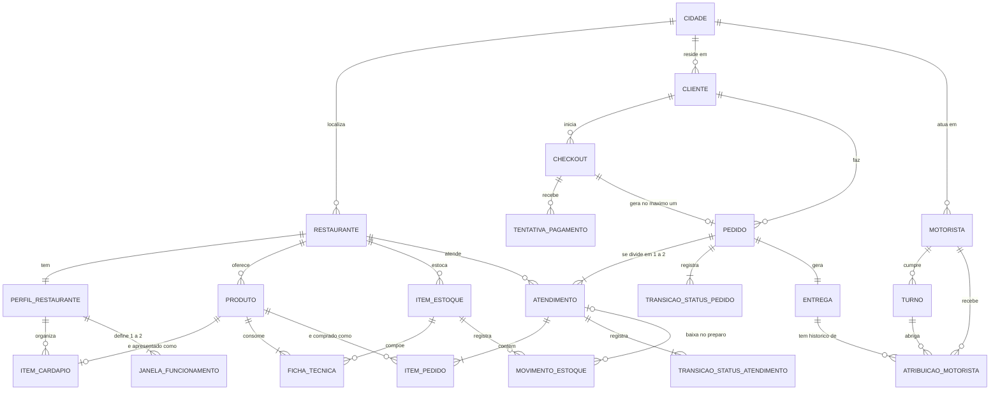
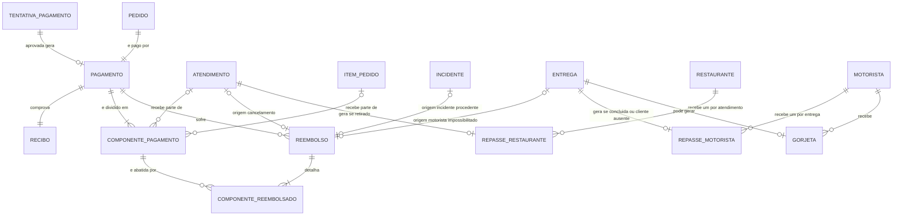
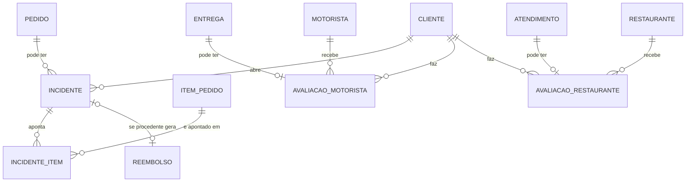

# 02 — Modelo conceitual

Etapa 2 do fluxo de modelagem: regras de negócio → adversarial → **conceitual** → lógico → físico → regeração dos dados.

**Status:** aprovado (2026-10-31); revisado em 2026-11-02 para o estoque por ficha técnica e movimentos ([ADR 007](../../../docs/adr/007-estoque-por-movimentos-e-gerador-hibrido.md)). Parte de [`01-regras-de-negocio.md`](01-regras-de-negocio.md) (RN-01 a RN-41) e do
modelo atual em [`../MODELO_CONCEITUAL_UBER_EATS.md`](../MODELO_CONCEITUAL_UBER_EATS.md) (14 entidades).

**Escopo.** Este documento diz **o que existe no negócio** e **como as coisas se relacionam**. Fica de fora, de propósito:
tipos de dado, chaves, normalização e em qual banco cada tabela mora (ADR 006). Isso é a etapa lógica e a física.
Os atributos citados abaixo são os que carregam regra de negócio; a lista completa de colunas nasce no lógico.

**Convenções.** Cardinalidades no Mermaid: `||` exatamente um, `o|` zero ou um, `}o` zero ou muitos, `}|` um ou muitos.
Cada entidade aponta para as RN que a originam. Status: **mantida** (já existe e continua igual), **alterada**, **nova**.

---

## 1. Visão geral

O modelo atual gira em torno de `Pedido` ligado direto a `Restaurante`, `Pagamento` e `Entrega`. As regras novas mudam o eixo:

- O pedido deixa de ter um restaurante e passa a ter **atendimentos** (um por restaurante, no máximo 2). O ciclo de vida
  operacional mora no atendimento; o status do pedido é derivado (RN-05, RN-16).
- O pagamento deixa de ser uma linha que muda de estado e passa a ser **checkout → tentativas → pagamento aprovado**,
  com todo dinheiro posterior (reembolso, repasse, gorjeta) como **eventos próprios** (RN-08, RN-15).
- O motorista deixa de ser um atributo do pedido e passa a ter **histórico de atribuições**, sempre dentro de um **turno
  aberto** (RN-31, RN-36).
- Avaliação, incidente e gorjeta viram o **pós-entrega**, cada um com regra própria (RN-14, RN-22, RN-26).
- **Cidade** vira referência canônica de restaurante, cliente e motorista (RN-03, RN-35).
- O estoque deixa de ser um número por produto e passa a ser de **itens de estoque** (pronto, pré-pronto ou insumo), ligados
  ao produto pela **ficha técnica** e alterados por **movimentos** (baixa no preparo, reposição fora das janelas) (RN-37 a RN-41).

Atores (RN-01): cliente, restaurante e motorista são entidades. A **plataforma** é o dono do sistema, não uma entidade
(não há mais de uma). O **governo** não é ator: imposto é componente do pagamento (RN-09).

---

## 2. Diagramas

Três recortes, para caber na tela do GitHub. Entidades que aparecem em mais de um recorte são as mesmas.

### 2.1 Operação: do cadastro à entrega

### 2.2 Dinheiro: pagamento, reembolso, repasse e gorjeta

Cada reembolso tem **uma única origem** (cancelamento de atendimento, incidente procedente ou entrega não concluída por motorista
impossibilitado); as três linhas são alternativas, não somam.

### 2.3 Pós-entrega: incidente e avaliação

---

## 3. Entidades

### 3.1 Cadastros e catálogo

| Entidade | Status | RN | O que é |
|---|---|---|---|
| Cliente | alterada (hoje `Usuário`) | RN-02, RN-35 | Quem compra. Dono de checkouts, pedidos, incidentes e avaliações. O nome muda para casar com o vocabulário das regras. Passa a referenciar `Cidade`. |
| Restaurante | alterada | RN-03, RN-23 | **Unidade física de retirada.** Passa a referenciar `Cidade`. Deixa de se ligar direto ao pedido: a ligação é pelo atendimento. |
| Cidade | **nova** | RN-03, RN-35 | Referência geográfica canônica. Permite verificar "mesma cidade" (restaurantes do pedido, endereço do cliente e cidade do motorista) sem comparar texto. |
| Perfil de Restaurante | alterada | RN-23, RN-41 | Cardápio e janelas de funcionamento. Agora é **obrigatório** (restaurante sem perfil não recebe pedido) e o menu referencia o produto, que carrega nome e preço. |
| Produto | mantida | RN-04, RN-32 | Item do cardápio de um restaurante. Pode mudar ou ser desativado sem afetar pedidos já aprovados, porque o item guarda cópia (ver `Item de Pedido`). |
| Item de Cardápio | **nova** | RN-23 | Entidade fraca do Perfil: apresentação de **um** produto do restaurante (seção, ordem, destaque, customizações). Nome e preço continuam no Produto. |
| Janela de Funcionamento | **nova** | RN-41 | Entidade fraca do Perfil: período de serviço do dia (início e fim, horário de Brasília). Uma ou duas por restaurante, iguais todos os dias na v1. Fora delas o restaurante não recebe pedido e é quando acontece a reposição. |
| Item de Estoque | alterada (era `Estoque`) | RN-37, RN-40 | O que o restaurante **estoca**, com unidade (unidade, grama, porção): o próprio produto pronto, um pré-pronto ou um insumo. Pertence a **um** restaurante. O saldo é o resultado dos movimentos. |
| Ficha Técnica | **nova** | RN-37, RN-38 | Liga produto e item de estoque com a **quantidade consumida** por unidade vendida. Todo produto tem ao menos uma linha; produto pronto tem uma linha apontando para si mesmo como item de estoque. Produto e item são do mesmo restaurante. |
| Movimento de Estoque | **nova** | RN-38, RN-39, RN-40 | Cada mudança do saldo: **baixa** (quando o atendimento entra em preparo, aponta o atendimento; no máximo uma por atendimento e item) ou **reposição** (só fora das janelas). O saldo nunca fica negativo. |
| Motorista | alterada | RN-06, RN-07, RN-35 | Quem entrega. Deixa de ser atributo do pedido; a ligação é pela atribuição. O `city` em texto passa a ser referência a `Cidade`. |
| Turno | alterada | RN-36 | Entidade fraca de Motorista, que o motorista **abre e fecha**. Só motorista com turno aberto recebe atribuição. Pedidos e ganho do turno são **derivados** das entregas e repasses reais. |

### 3.2 Compra e pedido

| Entidade | Status | RN | O que é |
|---|---|---|---|
| Checkout | **nova** | RN-15 | **Intenção de compra** de um cliente. Gera **no máximo um** pedido e um pagamento principal, mesmo que a aprovação chegue repetida (idempotência é conceito de negócio aqui). **Sem carrinho na v1**: guarda só a intenção e o valor; itens por tentativa ficam como evolução. |
| Tentativa de Pagamento | **nova** | RN-15 | Toda tentativa é registrada, aprovada ou recusada: valor, resultado, motivo da recusa, momento. A recusada nunca tem pedido. |
| Pedido | alterada | RN-02, RN-03, RN-11, RN-16, RN-24, RN-30 | Pertence a um cliente; só existe com pagamento aprovado. Tem 1 ou 2 atendimentos (mesma cidade) e no máximo 1 motorista por vez. **Status derivado** dos atendimentos até "a caminho"; depois, dirigido por eventos do pedido (entregue, concluído, não entregue). Guarda o **motivo** quando termina em não entregue (cliente ausente ou motorista impossibilitado). |
| Atendimento | **nova** | RN-05, RN-10, RN-12, RN-13, RN-28, RN-34 | Parte do pedido atendida por **um** restaurante (um por restaurante e por pedido). Tem ciclo de vida próprio: em análise, aceito, em preparo, pronto, retirado; terminais cancelado e rejeitado. Guarda tempo estimado de preparo (fixado no aceite), quem e por que cancelou ou rejeitou (inclusive "sem estoque", RN-39), e os instantes de chegada do motorista e de retirada (base do tempo de espera, RN-17). |
| Item de Pedido | alterada | RN-04, RN-32 | Entidade fraca de Atendimento. Passa a **guardar cópia** do nome do produto e do preço unitário da compra, além do identificador do produto, do restaurante vendedor, da quantidade e do total contratado. |
| Transição de Status de Atendimento | **nova** | RN-18 | Histórico das mudanças de status do atendimento (de, para, quem, quando). |
| Transição de Status de Pedido | **nova** | RN-18 | Histórico das mudanças de status do pedido. |
| Atribuição de Motorista | **nova** | RN-06, RN-07, RN-31, RN-36 | Cada atribuição, liberação e reatribuição de motorista a uma entrega, com momento, sempre dentro de um **turno aberto**. O motorista atual é o da atribuição vigente. Entrega sem motorista disponível fica "aguardando atribuição". |
| Entrega | alterada | RN-06, RN-17, RN-24, RN-30 | **Nasce junto com o pedido** e começa "aguardando atribuição". Carrega as atribuições de motorista, a rota e a finalização (ou o motivo da falha); a finalização dispara "entregue" e o relógio de 10 minutos da confirmação automática. Se todos os atendimentos forem cancelados, a entrega é cancelada. O motorista cumpre a entrega dentro do seu turno. |

### 3.3 Dinheiro

| Entidade | Status | RN | O que é |
|---|---|---|---|
| Pagamento | alterada | RN-08, RN-09, RN-19 | **Um por pedido**, sempre aprovado (recusa vira apenas tentativa). Compõe-se de itens, taxa de entrega e taxa de serviço, com imposto embutido, taxa da plataforma, taxa do meio de pagamento e valor líquido. Deixa de mudar de estado: o que acontece depois é reembolso. |
| Componente do Pagamento | **nova** | RN-20, RN-33 | Cada parte do pagamento **congelada na compra** por componente (item, taxa de serviço, taxa de entrega) e, quando cabe, por atendimento, com o imposto decomposto por componente. Não é recalculada a cada cancelamento. A taxa de entrega é uma só por pedido, nunca rateada. |
| Reembolso | **nova** | RN-08, RN-10, RN-14, RN-21, RN-30 | Evento posterior ligado ao pagamento; o pagamento em si nunca muda. Um pagamento tem zero ou muitos reembolsos. Cada reembolso tem **uma única origem**: cancelamento de atendimento, incidente procedente ou entrega não concluída por motorista impossibilitado. Registra quem arca (plataforma assume incidente e estorno por motorista impossibilitado). |
| Componente Reembolsado | **nova** | RN-33 | Quanto de cada componente do pagamento (item, taxa de serviço, taxa de entrega) o reembolso devolve. É o que garante que o acumulado por item nunca excede o valor do componente e que a ordem dos cancelamentos não muda o resultado. |
| Repasse ao Restaurante | **nova** | RN-29 | Valor devido ao restaurante: itens do atendimento menos comissão. Um por atendimento **retirado**; atendimento rejeitado, cancelado ou ainda não retirado não gera repasse. O restaurante recebe muitos ao longo do tempo. É obrigação reconhecida, não liquidação. |
| Repasse ao Motorista | **nova** | RN-29 | Ligado à **entrega**. Parcela fixa da taxa de entrega, devida só quando a entrega é concluída ou termina em cliente ausente. Não existe se todos os atendimentos forem cancelados nem se o motorista ficar impossibilitado. Vai ao motorista vigente na finalização. |
| Gorjeta | **nova** | RN-22, RN-26 | Pertence à **entrega**: no máximo uma por entrega, só de entrega concluída, direto ao motorista dela (que recebe muitas ao longo do tempo, uma por entrega). **Fora do pagamento**, não retida, não estornada. Não é oferecida se a nota do motorista for 3 ou menor. |
| Recibo | mantida | RN-08 | **Documento único da compra** (1:1 com pedido e pagamento). Reembolsos não o alteram: vivem na entidade Reembolso. |

### 3.4 Pós-entrega

| Entidade | Status | RN | O que é |
|---|---|---|---|
| Incidente | alterada | RN-14, RN-24, RN-30 | Reclamação sobre pedido retirado/entregue, aberta em até 24 h. Tem **desfecho**: aberto, em análise, procedente ou improcedente; só o procedente gera reembolso. Tem **motivo** (item faltando, item errado, qualidade do alimento, atraso, pedido não recebido, motorista impossibilitado), que define se a taxa de entrega volta. Não altera o estado operacional do pedido. |
| Incidente por Item | **nova** | RN-14 | Item(ns) e quantidade apontados. A soma reembolsada por item, entre todos os incidentes, nunca passa da quantidade comprada. Incidente de entrega (pedido não recebido, atraso) pode não apontar item. |
| Avaliação do Motorista | **nova** (divide a Avaliação atual) | RN-26 | Uma por **entrega**. Nota 1 a 5 obrigatória se existir, comentário livre opcional, prazo de 20 minutos. |
| Avaliação do Restaurante | **nova** (divide a Avaliação atual) | RN-26 | Uma por **atendimento retirado** de pedido entregue. Mesma nota, comentário e prazo. |

A `Avaliação` atual (1:1 com pedido, com restaurante deduzido) se divide em duas, porque nota de motorista e nota de
restaurante têm donos, cardinalidades e prazos de existência diferentes.

---

## 4. Relacionamentos que mudam de natureza

| Relacionamento | Antes | Agora | RN |
|---|---|---|---|
| Restaurante ↔ Pedido | 1:N direto | **N:N via Atendimento** (pedido com 1 ou 2 restaurantes, mesma cidade) | RN-03, RN-05 |
| Pedido ↔ Item | 1:N | Pedido 1:N Atendimento 1:N Item (o item continua do pedido, por transitividade) | RN-04, RN-05 |
| Entrega ↔ Motorista | atributo do pedido | **N:N com histórico** via Atribuição; vigente = no máximo um; atribuição dentro de um turno aberto | RN-06, RN-07, RN-31, RN-36 |
| Pedido ↔ Pagamento | 1:1 com 4 estados finais | 1:1 só aprovado; recusas viram Tentativa de um Checkout | RN-08, RN-11, RN-15 |
| Pedido ↔ Entrega | 1:1 | 1:1 (a entrega nasce com o pedido e passa por atribuição de motorista) | RN-06, RN-17 |
| Avaliação ↔ Pedido | 1:0..1 única | Motorista por pedido; Restaurante por atendimento | RN-26 |
| Pedido ↔ Incidente | 1:N | 1:N, agora com desfecho e itens apontados | RN-14 |
| Cliente / Motorista ↔ Cidade | texto solto no motorista; nada no cliente | Referência canônica a Cidade nos dois | RN-35 |
| Perfil de Restaurante ↔ Produto | menu solto, sem ligação | Via **Item de Cardápio** (apresentação de um produto do próprio restaurante) | RN-23 |
| Turno ↔ Atribuição | sem ligação | Atribuição ocorre dentro de um turno aberto | RN-36 |
| Produto ↔ Estoque | 1:1 (um número por produto) | **N:N via Ficha Técnica** com Item de Estoque; saldo por **movimentos** | RN-37, RN-38 |
| Atendimento ↔ Estoque | sem ligação | Atendimento gera **baixas** ao entrar em preparo | RN-38 |

---

## 5. O que muda em relação ao modelo atual

Modelo atual: 14 entidades. Modelo-alvo: **33**, sendo 20 novas, 11 alteradas e 2 mantidas.

| Entidade atual | Destino |
|---|---|
| Usuário | alterada, renomeada para Cliente (cidade) |
| Restaurante | alterada (cidade; sai a ligação direta com o pedido) |
| Produto | mantida |
| Motorista | alterada (cidade em vez de texto; atribuição pelo turno) |
| Pedido | alterada (atendimentos, status derivado, motivo de não entrega) |
| Item de Pedido | alterada (cópia de nome e preço; pertence ao atendimento) |
| Pagamento | alterada (só aprovado; sem máquina de estados) |
| Entrega | alterada (nasce com o pedido; leva as atribuições) |
| Avaliação | **dividida** em Avaliação do Motorista e do Restaurante |
| Recibo | mantida |
| Estoque | alterada, renomeada para Item de Estoque (pronto, pré-pronto ou insumo; saldo por movimentos) |
| Turno | alterada (abre e fecha; derivado das entregas reais) |
| Incidente | alterada (desfecho, motivos novos, itens apontados) |
| Perfil de Restaurante | alterada (obrigatório; menu referencia produto; janelas de funcionamento) |

**Novas (20):** Cidade, Item de Cardápio, Janela de Funcionamento, Ficha Técnica, Movimento de Estoque, Checkout, Tentativa de Pagamento, Atendimento, Transição de Status de Atendimento, Transição de Status de Pedido,
Atribuição de Motorista, Componente do Pagamento, Reembolso, Componente Reembolsado, Repasse ao Restaurante, Repasse ao Motorista,
Gorjeta, Incidente por Item, Avaliação do Motorista e Avaliação do Restaurante. O tempo de espera do motorista
fica como atributo do Atendimento (decisão 3).

**Reinterpretações que desfazem decisões da Onda 3** (registradas no modelo atual):

- O histórico de status de Pedido e de Pagamento tinha sido **removido** em favor de mutação de linha capturada por CDC.
  A RN-18 exige histórico de transições nos dois níveis, então `Transição de Status de Atendimento` e `Transição de Status de Pedido`
  voltam como entidades de negócio. O CDC não substitui isso: ele captura o que o banco gravou, e atualizações
  intermediárias podem se perder entre uma captura e outra. Isto pode virar ADR no lógico.
- O estado do Pagamento (`pending`, `failed`, estados finais) sai, porque pagamento recusado não gera pedido (RN-11).
  O que era estado vira Tentativa.
- A categoria de Incidente **"Payment Issue"** do gerador antigo não tem regra que a sustente (pagamento recusado nem gera
  pedido) e foi **retirada** por decisão do usuário. A categoria **"Other"** também foi retirada (sem efeito financeiro definido).
- O **Turno** deixa de ser um registro solto, com `num_orders` e ganho sorteados, e passa a ser derivado das entregas reais.
- O **Estoque** deixa de ser um instantâneo estático (quantidade aleatória, nunca atualizada) e passa a ser de itens de
  estoque com ficha técnica, alterados por baixa no preparo e reposição fora das janelas (ADR 007).

---

## 6. Rastreabilidade RN → entidade

| RN | Entidades principais |
|---|---|
| RN-01 | Cliente, Restaurante, Motorista (plataforma e governo não são entidades) |
| RN-02 | Cliente, Pedido |
| RN-03 | Cidade, Restaurante, Atendimento |
| RN-04 | Item de Pedido, Produto |
| RN-05, RN-16, RN-18 | Atendimento, Pedido, Transição de Status de Atendimento, Transição de Status de Pedido |
| RN-06, RN-07, RN-31 | Atribuição de Motorista |
| RN-08 | Pagamento, Reembolso |
| RN-09, RN-19, RN-20, RN-33 | Pagamento, Componente do Pagamento, Componente Reembolsado |
| RN-10, RN-12, RN-13, RN-34 | Atendimento (cancelamento e rejeição), Reembolso |
| RN-11, RN-15 | Checkout, Tentativa de Pagamento, Pagamento |
| RN-14, RN-30 | Incidente, Incidente por Item, Reembolso |
| RN-17, RN-28 | Atendimento (tempos), Entrega |
| RN-21 | Reembolso, Componente Reembolsado |
| RN-22 | Gorjeta |
| RN-23 | Perfil de Restaurante, Item de Cardápio, Produto |
| RN-24, RN-25 | Pedido, Entrega |
| RN-26 | Avaliação do Motorista, Avaliação do Restaurante |
| RN-27 | Regra de ordenação sobre eventos; não gera entidade, vira restrição no lógico |
| RN-29 | Repasse ao Restaurante, Repasse ao Motorista |
| RN-32 | Item de Pedido |
| RN-35 | Cidade, Cliente, Motorista, Restaurante |
| RN-36 | Turno, Atribuição de Motorista |
| RN-37 | Item de Estoque, Ficha Técnica, Produto, Checkout |
| RN-38, RN-39 | Movimento de Estoque, Ficha Técnica, Atendimento |
| RN-40, RN-41 | Movimento de Estoque, Janela de Funcionamento, Perfil de Restaurante |

---

## 7. Fica para o lógico (não é conceitual)

- Quais status são colunas e quais são derivados (RN-16 manda derivar o status do pedido até "a caminho").
- Granularidade exata do Componente do Pagamento (por item, atendimento ou pedido) e como os componentes de imposto são guardados.
- Chaves, tipos, centavos e regra de "última parcela absorve a diferença" (RN-33).
- Restrições de RN-27 (quem registrou primeiro) e de limites de tempo (RN-28).
- Janelas de 24 h, 20 min e 10 min como parâmetros, não como colunas.
- Se o saldo do item de estoque é coluna mantida pelo simulador ou só a soma dos movimentos, e como se calcula o comprometido (RN-39).
- Como a janela do turno restringe a atribuição.
- Em qual banco mora cada entidade (ADR 006).

---

## 8. Decisões registradas e pendência

Respostas do usuário às perguntas do rascunho (2026-10-30):

| # | Pergunta | Decisão |
|---|---|---|
| 1 | O Checkout carrega o carrinho? | **Não na v1.** Entidade existe só com intenção e valor; o carrinho é uma evolução possível sem refazer o modelo |
| 2 | Cidade para Cliente e Motorista? | **Sim para os dois**, com a regra nova RN-35 (entrega só dentro da cidade dos restaurantes) |
| 3 | Espera do motorista: atributo ou evento? | **Atributo do Atendimento** (chegada e retirada) |
| 4 | Retirar a categoria "pagamento" do Incidente? | **Retiradas**: "Payment Issue" e "Other" |
| 5 | Recibo reflete reembolsos? | **Não.** Documento único da compra |
| 6 | Estoque e Turno | **Turno: sim** (RN-36). **Estoque:** *revisado em 2026-11-02*, ver abaixo |

Decididos depois, na revisão da PR: a categoria **"Other"** também sai; o motorista **só aceita entrega dentro da sua cidade**
(RN-35 confirmada). Um **limite por quilometragem** fica fora da v1: exigiria posição do motorista e distância até o
restaurante, que o modelo não tem.

Revisão de 2026-11-02 (durante o modelo lógico, [ADR 007](../../../docs/adr/007-estoque-por-movimentos-e-gerador-hibrido.md)):

| # | Pergunta | Decisão |
|---|---|---|
| 7 | O que se estoca? | **Varia por produto**: pronto, pré-pronto ou insumo, todos como Item de Estoque, com ficha técnica |
| 8 | Quando o estoque baixa? | Quando o atendimento entra em **em preparo** (RN-38) |
| 9 | Falta de estoque depois do checkout | Restaurante **rejeita no aceite** com motivo "sem estoque" (RN-39) |
| 10 | Cancelamento depois do preparo devolve estoque? | **Não** (RN-38) |
| 11 | Quando repõe? | Só **fora das janelas** de funcionamento, 1 ou 2 por dia, iguais todos os dias (RN-40, RN-41) |

**Pendências:** nenhuma de decisão de negócio nesta etapa.
