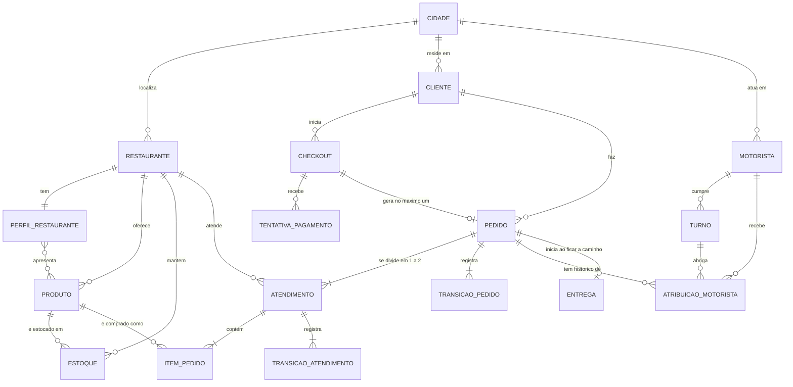
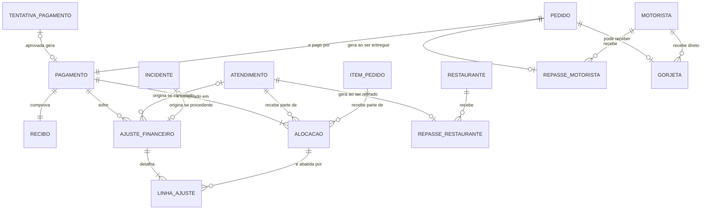
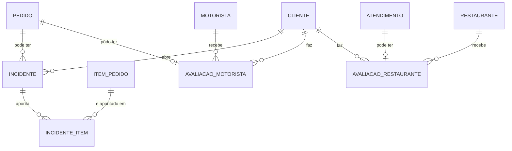

# 02 — Modelo conceitual

Etapa 2 do fluxo de modelagem: regras de negócio → adversarial → **conceitual** → lógico → físico → regeração dos dados.

**Status:** para revisão (decisões das perguntas 1 a 6 incorporadas, 2026-10-30). Parte de [`01-regras-de-negocio.md`](01-regras-de-negocio.md) (RN-01 a RN-37) e do
modelo atual em [`../MODELO_CONCEITUAL_UBER_EATS.md`](../MODELO_CONCEITUAL_UBER_EATS.md) (14 entidades).

**Escopo.** Este documento diz **o que existe no negócio** e **como as coisas se relacionam**. Fica de fora, de propósito:
tipos de dado, chaves, normalização e em qual banco cada tabela mora (ADR 006). Isso é a etapa lógica e a física.
Os atributos citados abaixo são os que carregam regra de negócio; a lista completa de colunas nasce no lógico.

**Convenções.** Cardinalidades no Mermaid: `||` exatamente um, `o|` zero ou um, `}o` zero ou muitos, `}|` um ou muitos.
Cada entidade aponta para as RN que a originam. Status: **mantida** (já existe e continua igual), **alterada**, **nova**.

---

## 1. Visão geral

O modelo atual gira em torno de `Pedido` ligado direto a `Restaurante`, `Pagamento` e `Entrega`. As regras novas mudam o eixo:

- O pedido deixa de ter um restaurante e passa a ter **atendimentos** (um por restaurante, no máximo 2). O ciclo de vida
  operacional mora no atendimento; o status do pedido é derivado (RN-05, RN-16).
- O pagamento deixa de ser uma linha que muda de estado e passa a ser **checkout → tentativas → pagamento aprovado**,
  com todo dinheiro posterior (reembolso, repasse, gorjeta) como **eventos próprios** (RN-08, RN-15).
- O motorista deixa de ser um atributo do pedido e passa a ter **histórico de atribuições**, sempre dentro de um **turno
  aberto** (RN-31, RN-36).
- Avaliação, incidente e gorjeta viram o **pós-entrega**, cada um com regra própria (RN-14, RN-22, RN-26).
- **Cidade** vira referência canônica de restaurante, cliente e motorista (RN-03, RN-35).

Atores (RN-01): cliente, restaurante e motorista são entidades. A **plataforma** é o dono do sistema, não uma entidade
(não há mais de uma). O **governo** não é ator: imposto é componente do pagamento (RN-09).

---

## 2. Diagramas

Três recortes, para caber na tela do GitHub. Entidades que aparecem em mais de um recorte são as mesmas.

### 2.1 Operação: do cadastro à entrega

### 2.2 Dinheiro: pagamento, reembolso, repasse e gorjeta

### 2.3 Pós-entrega: incidente e avaliação

---

## 3. Entidades

### 3.1 Cadastros e catálogo

| Entidade | Status | RN | O que é |
|---|---|---|---|
| Cliente | alterada (hoje `Usuário`) | RN-02, RN-35 | Quem compra. Dono de checkouts, pedidos, incidentes e avaliações. O nome muda para casar com o vocabulário das regras. Passa a referenciar `Cidade`. |
| Restaurante | alterada | RN-03, RN-23 | **Unidade física de retirada.** Passa a referenciar `Cidade`. Deixa de se ligar direto ao pedido: a ligação é pelo atendimento. |
| Cidade | **nova** | RN-03, RN-35 | Referência geográfica canônica. Permite verificar "mesma cidade" (restaurantes do pedido, endereço do cliente e cidade do motorista) sem comparar texto. |
| Perfil de Restaurante | alterada | RN-23 | Cardápio e horários. Agora é **obrigatório** (restaurante sem perfil não recebe pedido) e o menu referencia o produto, que carrega nome e preço. |
| Produto | mantida | RN-04, RN-32 | Item do cardápio de um restaurante. Pode mudar ou ser desativado sem afetar pedidos já aprovados, porque o item guarda cópia (ver `Item de Pedido`). |
| Estoque | alterada | RN-37 | Associativa Restaurante × Produto com quantidade. **Muda ao longo do tempo** por eventos do restaurante (reposição, ajuste, esgotamento), não a cada venda. Produto sem estoque não entra em novo checkout. |
| Motorista | alterada | RN-06, RN-07, RN-35 | Quem entrega. Deixa de ser atributo do pedido; a ligação é pela atribuição. O `city` em texto passa a ser referência a `Cidade`. |
| Turno | alterada | RN-36 | Entidade fraca de Motorista, que o motorista **abre e fecha**. Só motorista com turno aberto recebe atribuição. Pedidos e ganho do turno são **derivados** das entregas e repasses reais. |

### 3.2 Compra e pedido

| Entidade | Status | RN | O que é |
|---|---|---|---|
| Checkout | **nova** | RN-15 | **Intenção de compra** de um cliente. Gera **no máximo um** pedido e um pagamento principal, mesmo que a aprovação chegue repetida (idempotência é conceito de negócio aqui). **Sem carrinho na v1**: guarda só a intenção e o valor; itens por tentativa ficam como evolução. |
| Tentativa de Pagamento | **nova** | RN-15 | Toda tentativa é registrada, aprovada ou recusada: valor, resultado, motivo da recusa, momento. A recusada nunca tem pedido. |
| Pedido | alterada | RN-02, RN-03, RN-11, RN-16, RN-24, RN-30 | Pertence a um cliente; só existe com pagamento aprovado. Tem 1 ou 2 atendimentos (mesma cidade) e no máximo 1 motorista por vez. **Status derivado** dos atendimentos até "a caminho"; depois, dirigido por eventos do pedido (entregue, concluído, não entregue). Guarda o **motivo** quando termina em não entregue (cliente ausente ou motorista impossibilitado). |
| Atendimento | **nova** | RN-05, RN-10, RN-12, RN-13, RN-28, RN-34 | Parte do pedido atendida por **um** restaurante (um por restaurante e por pedido). Tem ciclo de vida próprio: em análise, aceito, em preparo, pronto, retirado; terminais cancelado e rejeitado. Guarda tempo estimado de preparo (fixado no aceite), quem e por que cancelou, e os instantes de chegada do motorista e de retirada (base do tempo de espera, RN-17). |
| Item de Pedido | alterada | RN-04, RN-32 | Entidade fraca de Atendimento. Passa a **guardar cópia** do nome do produto e do preço unitário da compra, além do identificador do produto, do restaurante vendedor, da quantidade e do total contratado. |
| Transição de Atendimento | **nova** | RN-18 | Histórico das mudanças de status do atendimento (de, para, quem, quando). |
| Transição de Pedido | **nova** | RN-18 | Histórico das mudanças de status do pedido. |
| Atribuição de Motorista | **nova** | RN-06, RN-07, RN-31, RN-36 | Cada atribuição, liberação e reatribuição de motorista a um pedido, com momento, sempre dentro de um **turno aberto**. O motorista atual é o da atribuição vigente. Pedido sem motorista disponível fica "aguardando atribuição". |
| Entrega | alterada | RN-17, RN-24 | Existe só quando o pedido fica "a caminho" (todos os atendimentos ativos retirados). Guarda rota e finalização; a finalização dispara "entregue" e o relógio de 10 minutos da confirmação automática. Motorista vem da atribuição vigente. |

### 3.3 Dinheiro

| Entidade | Status | RN | O que é |
|---|---|---|---|
| Pagamento | alterada | RN-08, RN-09, RN-19 | **Um por pedido**, sempre aprovado (recusa vira apenas tentativa). Compõe-se de itens, taxa de entrega e taxa de serviço, com imposto embutido, taxa da plataforma, taxa do meio de pagamento e valor líquido. Deixa de mudar de estado: o que acontece depois é ajuste. |
| Alocação | **nova** | RN-20, RN-33 | Parcela do pagamento **congelada na compra** por componente (item, taxa de serviço, taxa de entrega) e, quando cabe, por atendimento, com o imposto decomposto por componente. Não é recalculada a cada cancelamento. A taxa de entrega é uma só por pedido, nunca rateada. |
| Ajuste Financeiro | **nova** | RN-08, RN-10, RN-14, RN-21, RN-30 | Evento posterior ligado ao pagamento (reembolso). Origem: cancelamento de atendimento, incidente procedente ou pedido não entregue por motorista impossibilitado. Registra quem arca (plataforma assume incidente e estorno por motorista impossibilitado). |
| Linha de Ajuste | **nova** | RN-33 | Quanto de cada alocação o ajuste devolve. É o que garante que o acumulado por item nunca excede o alocado e que a ordem dos cancelamentos não muda o resultado. |
| Repasse ao Restaurante | **nova** | RN-29 | Valor devido ao restaurante: itens do atendimento menos comissão. Devido **na retirada** e só de atendimento retirado. É obrigação reconhecida, não liquidação. |
| Repasse ao Motorista | **nova** | RN-29 | Parcela fixa da taxa de entrega, devida quando o pedido é entregue ou termina em cliente ausente; não devida se o motorista fica impossibilitado. |
| Gorjeta | **nova** | RN-22, RN-26 | Valor livre, no máximo uma por pedido, só de pedido entregue, direto ao motorista. **Fora do pagamento**, não retida, não estornada. Não é oferecida se a nota do motorista for 3 ou menor. |
| Recibo | mantida | RN-08 | **Documento único da compra** (1:1 com pedido e pagamento). Reembolsos não o alteram: vivem no Ajuste Financeiro. |

### 3.4 Pós-entrega

| Entidade | Status | RN | O que é |
|---|---|---|---|
| Incidente | alterada | RN-14, RN-24, RN-30 | Reclamação sobre pedido retirado/entregue, aberta em até 24 h. Tem **desfecho**: aberto, em análise, procedente ou improcedente; só o procedente gera ajuste. Tem **motivo** (item faltando, item errado, qualidade do alimento, atraso, pedido não recebido, motorista impossibilitado), que define se a taxa de entrega volta. Não altera o estado operacional do pedido. |
| Incidente por Item | **nova** | RN-14 | Item(ns) e quantidade apontados. A soma reembolsada por item, entre todos os incidentes, nunca passa da quantidade comprada. Incidente de entrega (pedido não recebido, atraso) pode não apontar item. |
| Avaliação do Motorista | **nova** (divide a Avaliação atual) | RN-26 | Uma por **pedido**. Nota 1 a 5 obrigatória se existir, comentário livre opcional, prazo de 20 minutos. |
| Avaliação do Restaurante | **nova** (divide a Avaliação atual) | RN-26 | Uma por **atendimento retirado** de pedido entregue. Mesma nota, comentário e prazo. |

A `Avaliação` atual (1:1 com pedido, com restaurante deduzido) se divide em duas, porque nota de motorista e nota de
restaurante têm donos, cardinalidades e prazos de existência diferentes.

---

## 4. Relacionamentos que mudam de natureza

| Relacionamento | Antes | Agora | RN |
|---|---|---|---|
| Restaurante ↔ Pedido | 1:N direto | **N:N via Atendimento** (pedido com 1 ou 2 restaurantes, mesma cidade) | RN-03, RN-05 |
| Pedido ↔ Item | 1:N | Pedido 1:N Atendimento 1:N Item (o item continua do pedido, por transitividade) | RN-04, RN-05 |
| Pedido ↔ Motorista | atributo | **N:N com histórico** via Atribuição; vigente = no máximo um; atribuição dentro de um turno aberto | RN-06, RN-07, RN-31, RN-36 |
| Pedido ↔ Pagamento | 1:1 com 4 estados finais | 1:1 só aprovado; recusas viram Tentativa de um Checkout | RN-08, RN-11, RN-15 |
| Pedido ↔ Entrega | 1:1 | 1:0..1 (só existe a partir de "a caminho") | RN-16, RN-17 |
| Avaliação ↔ Pedido | 1:0..1 única | Motorista por pedido; Restaurante por atendimento | RN-26 |
| Pedido ↔ Incidente | 1:N | 1:N, agora com desfecho e itens apontados | RN-14 |
| Cliente / Motorista ↔ Cidade | texto solto no motorista; nada no cliente | Referência canônica a Cidade nos dois | RN-35 |
| Perfil de Restaurante ↔ Produto | menu solto, sem ligação | Menu referencia o produto (N:N de apresentação) | RN-23 |
| Turno ↔ Atribuição | sem ligação | Atribuição ocorre dentro de um turno aberto | RN-36 |

---

## 5. O que muda em relação ao modelo atual

Modelo atual: 14 entidades. Modelo-alvo: **29**, sendo 16 novas, 11 alteradas e 2 mantidas.

| Entidade atual | Destino |
|---|---|
| Usuário | alterada, renomeada para Cliente (cidade) |
| Restaurante | alterada (cidade; sai a ligação direta com o pedido) |
| Produto | mantida |
| Motorista | alterada (cidade em vez de texto; atribuição pelo turno) |
| Pedido | alterada (atendimentos, status derivado, motivo de não entrega) |
| Item de Pedido | alterada (cópia de nome e preço; pertence ao atendimento) |
| Pagamento | alterada (só aprovado; sem máquina de estados) |
| Entrega | alterada (existe a partir de "a caminho") |
| Avaliação | **dividida** em Avaliação do Motorista e do Restaurante |
| Recibo | mantida |
| Estoque | alterada (muda por eventos do restaurante) |
| Turno | alterada (abre e fecha; derivado das entregas reais) |
| Incidente | alterada (desfecho, motivos novos, itens apontados) |
| Perfil de Restaurante | alterada (obrigatório; menu referencia produto) |

**Novas (16):** Cidade, Checkout, Tentativa de Pagamento, Atendimento, Transição de Atendimento, Transição de Pedido,
Atribuição de Motorista, Alocação, Ajuste Financeiro, Linha de Ajuste, Repasse ao Restaurante, Repasse ao Motorista,
Gorjeta, Incidente por Item, Avaliação do Motorista e Avaliação do Restaurante. O tempo de espera do motorista
fica como atributo do Atendimento (decisão 3).

**Reinterpretações que desfazem decisões da Onda 3** (registradas no modelo atual):

- O histórico de status de Pedido e de Pagamento tinha sido **removido** em favor de mutação de linha capturada por CDC.
  A RN-18 exige histórico de transições nos dois níveis, então `Transição de Atendimento` e `Transição de Pedido`
  voltam como entidades de negócio. O CDC não substitui isso: ele captura o que o banco gravou, e atualizações
  intermediárias podem se perder entre uma captura e outra. Isto pode virar ADR no lógico.
- O estado do Pagamento (`pending`, `failed`, estados finais) sai, porque pagamento recusado não gera pedido (RN-11).
  O que era estado vira Tentativa.
- A categoria de Incidente **"Payment Issue"** do gerador antigo não tem regra que a sustente (pagamento recusado nem gera
  pedido) e foi **retirada** por decisão do usuário. A categoria **"Other"** segue sem decisão (ver seção 8).
- O **Turno** deixa de ser um registro solto, com `num_orders` e ganho sorteados, e passa a ser derivado das entregas reais.
- O **Estoque** deixa de ser um instantâneo estático (quantidade aleatória, nunca atualizada) e passa a mudar no tempo.

---

## 6. Rastreabilidade RN → entidade

| RN | Entidades principais |
|---|---|
| RN-01 | Cliente, Restaurante, Motorista (plataforma e governo não são entidades) |
| RN-02 | Cliente, Pedido |
| RN-03 | Cidade, Restaurante, Atendimento |
| RN-04 | Item de Pedido, Produto |
| RN-05, RN-16, RN-18 | Atendimento, Pedido, Transição de Atendimento, Transição de Pedido |
| RN-06, RN-07, RN-31 | Atribuição de Motorista |
| RN-08 | Pagamento, Ajuste Financeiro |
| RN-09, RN-19, RN-20, RN-33 | Pagamento, Alocação, Linha de Ajuste |
| RN-10, RN-12, RN-13, RN-34 | Atendimento (cancelamento e rejeição), Ajuste Financeiro |
| RN-11, RN-15 | Checkout, Tentativa de Pagamento, Pagamento |
| RN-14, RN-30 | Incidente, Incidente por Item, Ajuste Financeiro |
| RN-17, RN-28 | Atendimento (tempos), Entrega |
| RN-21 | Ajuste Financeiro, Linha de Ajuste |
| RN-22 | Gorjeta |
| RN-23 | Perfil de Restaurante, Produto |
| RN-24, RN-25 | Pedido, Entrega |
| RN-26 | Avaliação do Motorista, Avaliação do Restaurante |
| RN-27 | Regra de ordenação sobre eventos; não gera entidade, vira restrição no lógico |
| RN-29 | Repasse ao Restaurante, Repasse ao Motorista |
| RN-32 | Item de Pedido |
| RN-35 | Cidade, Cliente, Motorista, Restaurante |
| RN-36 | Turno, Atribuição de Motorista |
| RN-37 | Estoque, Produto, Checkout |

---

## 7. Fica para o lógico (não é conceitual)

- Quais status são colunas e quais são derivados (RN-16 manda derivar o status do pedido até "a caminho").
- Granularidade exata da Alocação (por item, atendimento ou pedido) e como os componentes de imposto são guardados.
- Chaves, tipos, centavos e regra de "última parcela absorve a diferença" (RN-33).
- Restrições de RN-27 (quem registrou primeiro) e de limites de tempo (RN-28).
- Janelas de 24 h, 20 min e 10 min como parâmetros, não como colunas.
- Como a mudança de estoque é registrada (atributo atualizado ou movimentos) e como a janela do turno restringe a atribuição.
- Em qual banco mora cada entidade (ADR 006).

---

## 8. Decisões registradas e pendência

Respostas do usuário às perguntas do rascunho (2026-10-30):

| # | Pergunta | Decisão |
|---|---|---|
| 1 | O Checkout carrega o carrinho? | **Não na v1.** Entidade existe só com intenção e valor; o carrinho é uma evolução possível sem refazer o modelo |
| 2 | Cidade para Cliente e Motorista? | **Sim para os dois**, com a regra nova RN-35 (entrega só dentro da cidade dos restaurantes) |
| 3 | Espera do motorista: atributo ou evento? | **Atributo do Atendimento** (chegada e retirada) |
| 4 | Retirar a categoria "pagamento" do Incidente? | **Retirada** ("Payment Issue") |
| 5 | Recibo reflete reembolsos? | **Não.** Documento único da compra |
| 6 | Estoque e Turno | **Turno: sim** (RN-36). **Estoque: muda por eventos do restaurante** (RN-37), não por venda |

**Pendência.** A categoria **"Other"** do incidente (gerador antigo) não tem efeito financeiro definido. Decidir se sai, como
"Payment Issue", ou se fica como motivo "outro" sem ajuste. Também a parte final da RN-35 (o motorista só atua na sua cidade)
está marcada como a confirmar.
